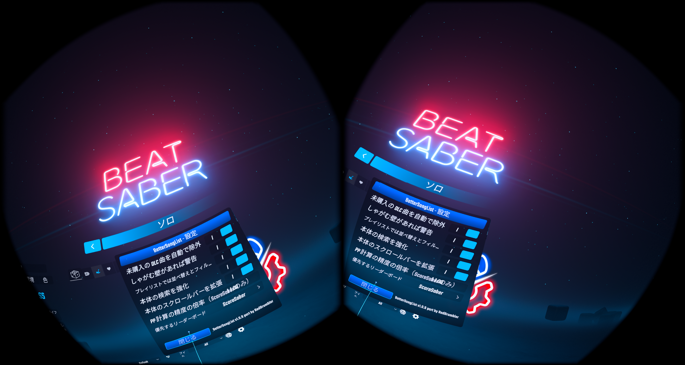

# JapaneseLocalizer（Quest 版 Beat Saber）

Quest 版 Beat Saber（1.40.8_7379）で、**ほかの Mod の UI を日本語にする Mod** です。Beat Saber 本体は公式に日本語に対応しているので、この Mod が訳すのは Mod の設定画面などの UI だけです。

> **English summary**
> A Quest Beat Saber (1.40.8_7379) mod that translates the UI of *other mods* into Japanese, using per-mod JSON dictionaries. It hooks the functions that build UI (BSML parser, BSML-Lite, ChatPlex SDK) instead of rewriting every rendered text, so song names and player input are not touched. See the supported mod list below. Requests: open an Issue or contact [@fruitriin on X](https://x.com/fruitriin).



## 対応している Mod

2026年11月に、実機の Quest 3（Beat Saber 1.40.8_7379）で確かめた版を書いています。各 Mod が更新されて原文が変わると、その部分は英語のまま表示されます。

| Mod | 確かめた版 | 訳せる範囲 |
|---|---|---|
| AnyText | 1.0.1 | 設定画面 |
| Airbuds Search | 2.0.2 | 設定画面と検索画面 |
| BeatLeader | 0.9.666 | 設定画面、ログイン画面、一部のモーダル。リーダーボード、スコアの詳細、ニュース、イベントのパネルは訳せない |
| BeatLeader の追加モディファイア（ModifiersCoreQuest） | BeatLeader 0.9.666 に同梱 | 曲の「ルール変更」の CUSTOM タブ（名前と説明） |
| BeatSaberPlus（GameTweaker / MenuMusic / Multiplayer / NoteTweaker） | 6.4.5 | 設定画面（ChatPlex SDK の UI） |
| BeatSync | 0.1.2 | 設定画面 |
| BetterHaptics | 0.1.1 | 設定画面 |
| BetterSongList | 1.0.8、改造版 1.0.12 | 並べ替え・絞り込みの UI、設定画面 |
| BetterSongSearch | 2.2.13 | 検索画面、絞り込み、設定画面 |
| BSML | 0.4.55 | BSML が出す共通の UI（Mod 設定のメニューなど） |
| ChatPlex SDK | 6.4.5 | 共通の UI |
| Clock Mod | 1.15.0 | 設定画面 |
| Easy Offset Quest | 0.1.7 | 設定画面（「Save As」は収まる訳が無いので英語のまま） |
| HeartBeatQuest | 0.4.1、0.4.2 | 設定画面（BSML-Lite で作る部分）。AssetBundle で作る心拍数の表示は訳せない |
| HidePacks | 0.1.1 | 設定画面 |
| ImageCoverExpander | 0.2.4 | 設定画面 |
| Intro Skip | 1.2.2 | 設定画面 |
| JDFixer | 3.4.0 | 設定画面 |
| NoodleExtensions | 1.6.3 | 設定画面 |
| PlaylistCore | 1.5.5 | プレイリストの UI |
| PlaylistManager | 1.4.1 | プレイリストの UI |
| RandomSongPicker | 0.4.0 | ボタンと設定 |
| RecentlyPlayed | 1.0.0 | 設定画面 |
| RedBar | 1.19.0、1.19.1 | 設定画面 |
| SongCore | 1.1.26 | 必要な要素の一覧などの UI |
| SongDownloader | 0.8.8 | 検索画面と設定画面。コードから直接書き込む一部のメッセージ（「Please type in a Username!」など）は訳せない |
| SongPlayHistory（Quest 版） | 0.1.2 | 設定画面と、曲の詳細画面のプレイ回数 |
| Spotify Search | 1.2.1 | 設定画面と検索画面 |
| Transitions | 1.2.3 | 設定画面 |
| TrickSaber Lite | 0.1.1 | 設定画面 |

辞書は `dictionaries/` にあります。どの Mod にも出てくる短い言葉（「Enabled」「Reset」など）は `_common.json` にまとめています。

## 対応してほしい Mod や、訳の直しの要望

**対応してほしい Mod がある、訳がおかしい、文字が枠からはみ出す**といったときは、このリポジトリの **Issue** か、**X の [@fruitriin](https://x.com/fruitriin)** までお知らせください。

次の情報があると助かります。
- Mod の名前と版（MBF の一覧に出ている版）
- 訳がおかしい場合は、その画面のスクリーンショット
- 設定の「未翻訳収集モード」をオンにして画面を開くと、訳の無い文字列が `untranslated.json` に、1行に収まらない訳が `overflow.json` に書き出されます。このファイルを添えてもらえると、すぐに辞書に足せます（場所は下の「辞書と書き出しファイル」）

## 入れ方

1. [Releases](../../releases) から qmod（`Japanese.Localizer.qmod` など）をダウンロードする
2. [MBF](https://mbf.bsquest.xyz/) の「Upload Files」から qmod を読み込む

辞書は、qmod を入れるときに自動で配置されます。

必要な Mod（MBF が自動で入れます）: beatsaber-hook、BSML、custom-types、paperlog、tinyxml2

## 設定

Mod 設定の「日本語化」から変えられます。

| 設定 | 初期値 | 内容 |
|---|---|---|
| 日本語に置き換える | オン | 翻訳のオン / オフ |
| 未翻訳収集モード | オフ | 訳の無い文字列と、1行に収まらない訳をファイルに書き出す。3秒ごとに画面の文字を点検するので、普段はオフにしておく |
| 曲名の省略を直す | オン | 曲一覧で「祝福/The Blessing」のように日本語と英字が混ざる曲名が「祝…」と省略されるのを直す |
| ルール変更の追加項目を訳す | オン | 曲の「ルール変更」の CUSTOM タブに Mod が足す項目を訳す |
| 日本語フォントをそろえる | オン | 一部の漢字が中国語の字形で表示されるのを防ぐ。端末の Noto Sans CJK を使う |

「曲名の省略を直す」と「日本語フォントをそろえる」は、訳とは別に、ゲーム全体の文字の見た目を変えます。気になるときはオフにしてください。

## 辞書と書き出しファイル

- 置き場所: `/sdcard/ModData/com.beatgames.beatsaber/Mods/JapaneseLocalizer/<Mod名>.json`
- 形式: `{"原文": "訳"}`。`{0}` を含む見出し語はテンプレートとして照合する（例: `"{0} songs": "{0} 曲"`）
- 引く順: その Mod の辞書 → `_common.json` → 全辞書
- 辞書を書き換えたら、設定の「辞書を読み直す」を押す。一度作られた画面は作り直されないので、確実に見るにはゲームを再起動する

## しくみ

文字を描画する段階（TMP）ですべての文字を置き換えるのではなく、**UI の部品を作る関数に渡される文字列**を訳します。曲名、プレイヤー名、入力欄などを誤って訳さないためです。

| 対象 | フックする関数 | 訳すもの |
|---|---|---|
| .bsml | `BSML::BSMLParser::parse` | `text`、`hover-hint`、`tab-name` などの属性。`~` で始まる値と、`choices`・`options` は訳さない（値が変わると Mod の動作が壊れるため） |
| BSML-Lite | `CreateText`、`CreateUIButton`、`CreateToggle`、`CreateSliderSetting`、`CreateIncrementSetting`、`CreateStringSetting`、`CreateDropdown`（ラベルだけ）、`AddHoverHint`、`SetButtonText`、`CreateClickableText`、`CreateColorPicker` など | 表示する文字列 |
| ChatPlex SDK（BeatSaberPlus） | `CText::SetText`、`CPOrSButton::SetText` / `SetTooltip`、`CTextInput::SetPlaceHolder`、`TopNavigationView::SetTitle`、`CTextSegmentedControl::SetTexts` | 表示する文字列。`CDropdown::SetOptions` は訳さない |
| ModifiersCoreQuest | 公開されている辞書を直接書き換える | ルール変更の CUSTOM タブの名前と説明 |

どの Mod の文字列かは、呼び出し元の .so の名前から決めます（`libsongdownloader.so` → `songdownloader`）。ChatPlex SDK の関数は名前で探してフックするので、版が変わって見つからなければ、何もせずに飛ばします。

### 訳せない文字
- Mod がコードから TMP に直接書き込む文字（`text->set_text(...)`）
- AssetBundle に入っている UI の文字
- プルダウンの選択肢（値と表示が同じ文字列なので、訳すと Mod の動作が壊れる）

### AnyText との関係
AnyText は、文字を描画する段階で `Configs/anytext.json` の規則に従って文字を置き換えます。この Mod は部品を作る段階で訳すので、フックする関数は重なりません。ただし、英語の原文に合わせて書いた AnyText の規則は、この Mod が訳した後の文字には当たらなくなります。

## ビルド

[qpm](https://github.com/QuestPackageManager/QPM.CLI) と PowerShell（`pwsh`）が必要です。

```bash
qpm restore
qpm ndk resolve
qpm s build -- -release
rm -f mod.json && qpm s qmod
```

- 辞書の元データは `tools/dicts_*.py` にある。`python3 tools/build_dicts.py` で `dictionaries/` と `mod.template.json` の `fileCopies` を作り直す
- `mod.json` が残っていると古い依存の範囲で qmod が作られるので、qmod を作る前に消す
- 開発中のメモ（1行に収まらない訳の一覧と短縮案）とスクリーンショットは `docs/` にある

## ライセンス

[MIT License](LICENSE)

辞書に載っている原文は、それぞれの Mod の UI の文字列です。各 Mod の作者に権利があります。
